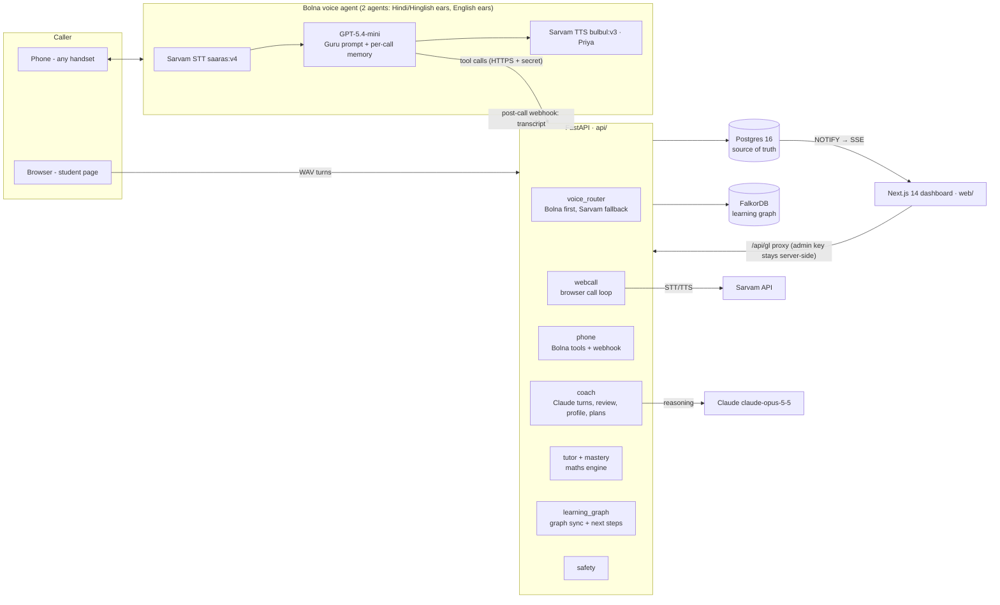
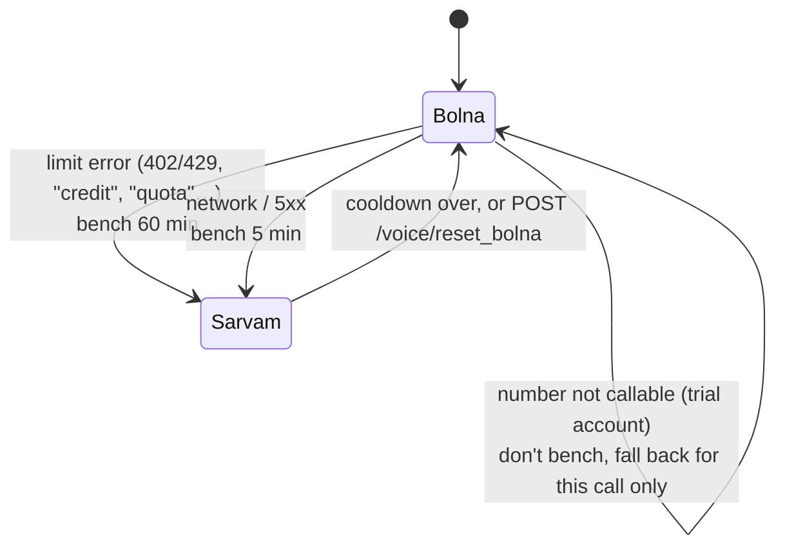

# Guru Line — an AI mentor on a normal phone call

**Guru is a voice mentor that anyone can call: a student in a village, a college learner, a job seeker or a working professional.** No app, no internet and no smartphone are needed for the phone version. Guru speaks Hindi, English or a mix. It remembers every call, understands the person's real problem, gives one practical next step, and follows up next time.

Built for the **Bolna Buildathon** with Bolna (voice agent and telephony), Sarvam (Indian-language speech), Claude (reasoning and memory), Postgres and FalkorDB (learning graph).

---

## Contents

1. [The problem](#1-the-problem)
2. [What Guru does](#2-what-guru-does)
3. [Impact: who it helps and how we measure it](#3-impact-who-it-helps-and-how-we-measure-it)
4. [Architecture](#4-architecture)
5. [How a call works](#5-how-a-call-works)
6. [Memory: how every call builds on the last](#6-memory-how-every-call-builds-on-the-last)
7. [Algorithms](#7-algorithms)
8. [Data model](#8-data-model)
9. [Safety, consent and privacy](#9-safety-consent-and-privacy)
10. [Product and UI design](#10-product-and-ui-design)
11. [Engineering decisions and measured results](#11-engineering-decisions-and-measured-results)
12. [Run it locally](#12-run-it-locally)
13. [Configuration](#13-configuration)
14. [Tests](#14-tests)
15. [Repository layout](#15-repository-layout)
16. [Limitations and roadmap](#16-limitations-and-roadmap)

---

## 1. The problem

Most learners in India, especially in villages and small towns, have no one to talk to about their studies, career or confidence. Nobody remembers where they struggled last week. Tutoring apps assume a smartphone, data, English and a fixed syllabus.

The phone still reaches everyone. Guru Line puts a patient, knowledgeable mentor behind an ordinary phone call, in the caller's own language.

## 2. What Guru does

| | |
|---|---|
| **Calls you, or you talk in the browser** | Bolna places a real phone call. If Bolna is unavailable, the student gets a Sarvam browser call automatically. |
| **Speaks your language** | The first call always asks: Hindi, English or a mix? After that, Guru speaks only that language: Hindi in Devanagari, Hinglish in Latin script, or simple English. |
| **Mentors on any problem** | Studies, exams, career after 10th or 12th, scholarships, job skills, spoken English, confidence, focus and habits. There's no fixed syllabus. Maths and English speaking are optional focused modes. |
| **Listens first** | Guru answers the person's question before asking anything. It keeps turns short and waits when someone pauses mid-sentence. |
| **Remembers and follows up** | After every call, Claude updates Guru's notes on the person: open problems with their root cause and status, what was tried and whether it worked, what motivates them, and the next new topic. The next call opens with a line that links to the last one. |
| **Mentors with evidence** | One psychology insight or proven method per call, explained simply: spacing, active recall, growth mindset, the spotlight effect, implementation intentions. Plus real books by real authors, saved to the learner's journal. |
| **Shows progress** | A simple student view with a day-by-day journal, goals with a 4-week plan, and progress by day, week and month. An Advanced view adds the learning graph, skills, confidence vs performance, and research-ranked next best steps. |
| **Keeps adults informed** | A short summary in Hindi for parents, a three-line note per student for teachers, and a class heatmap of common mistakes. |

## 3. Impact: who it helps and how we measure it

**Who it's for.** The default user is a **rural student**: Hindi-first, a basic phone, little or no internet, and little money for coaching. Guru is open to everyone else too. Design choices that follow from this:

- **A phone call is the main channel.** It works on any phone, with no data.
- **Hindi and Hinglish first.** The opening asks the language, and Sarvam's Indian-language speech models handle accents and code-mixing.
- **Practical advice.** Concrete next steps, with no assumption of paid courses or a laptop.
- **Short, low-pressure calls.** About 10 minutes, one idea at a time, with no judgement.

**What we measure** (stored per learner, visible in the dashboard):

| Signal | Source | Why it matters |
|---|---|---|
| Skill scores, 0–10 | Claude's review of each call (fluency, grammar, understanding, application…) | Progress by day, week and month |
| Self-reported confidence, 1–10 | Asked during calls; **never inferred from the voice** | Confidence vs performance (calibration) |
| Mastery and misconception strength | Bayesian Knowledge Tracing and the misconception model (maths mode) | Whether a specific mistake is actually fading |
| Open problems: new → improving → solved | The learner profile, updated after every call | Real-life follow-through, not just quiz scores |
| Resources given and plans followed | Journal and goals | Whether advice turns into action |

The Proof page is built for a synthetic evaluation. Its 30 cases aren't run yet, so it shows "— / 30" rather than invented numbers (see [roadmap](#16-limitations-and-roadmap)).

## 4. Architecture



**Responsibilities**

| Layer | What it owns |
|---|---|
| **Bolna** | Telephony, turn-taking, live conversation (GPT-5.4-mini), Sarvam STT/TTS during phone calls. It's configured entirely from code (`scripts/bolna_sync_agent.py`). |
| **Sarvam** | Indian-language speech on both channels, plus transliteration (Devanagari → Latin) for English and Hinglish speakers' transcripts. |
| **Claude** | Browser-call turns; after every call: review, skill scores, learner profile, 4-week plans, progress feedback. It runs off the call's critical path, so a slow LLM never delays speech. |
| **FastAPI** | Tools that Bolna calls mid-call, the webhook, the browser call loop, voice routing, the maths engine, the dashboard APIs. |
| **Postgres** | The source of truth for everything: sessions, transcripts, reviews, scores, consent, audit. |
| **FalkorDB** | A derived, rebuildable graph of what the learner knows, struggles with and is working toward. It powers the Advanced view. |
| **Next.js** | Landing, sign-up, student view, Advanced view, teacher, parent, privacy and proof pages. A server-side proxy keeps the admin key out of the browser. |

## 5. How a call works

### Phone call (Bolna)

```mermaid
sequenceDiagram
    participant S as Student
    participant API as Guru API
    participant BO as Bolna
    participant CL as Claude

    API->>API: create session; build per-call variables<br/>(greeting, memory, session_id)
    API->>BO: POST /call (user_data = variables)<br/>English learners → English agent
    API->>API: bind Bolna execution_id to the session
    BO->>S: rings; speaks {greeting}<br/>(language question, or a link to the last call)
    loop each turn
      S->>BO: speech
      BO->>BO: Sarvam STT → GPT-5.4-mini → Sarvam TTS
      BO-->>API: tools: set_language · choose_topic · set_goal ·<br/>save_suggestion · log_confidence · submit_answer · end_session
    end
    BO->>API: webhook (status + transcript), repeated per status
    API->>API: find session (call id → passed session id →<br/>fresh phone session → create); save transcript
    API->>CL: review + skill scores → learner profile
    API->>API: sync learning graph; emit live events
```

- **Never lose a call.** The session exists before the phone rings, and the webhook matches it in four fallback steps. At startup the API also pulls recent calls from Bolna's history and saves any whose webhook was missed, for example while the public tunnel was down.
- **Personal from the first second.** The greeting and memory are passed into the call itself, so Guru knows the learner even if a tool call is slow.
- **The opening line is instant.** It's built in code from Guru's notes, with no LLM call, for example: *"Hi Piyush! It's Guru, your AI coach. You told me you want corporate English for work. Today shall we practise introducing yourself in an office meeting?"*

### Browser call (Sarvam fallback)

Each turn goes **browser mic → WAV (adaptive voice detection) → Sarvam STT → Claude coach turn (JSON) → Sarvam TTS, one sentence at a time and in parallel → browser**. The page detects when the speaker stops, so the call is hands-free after one tap. The chat transcript appears in the learner's own script.

### Voice routing and fallback



## 6. Memory: how every call builds on the last

After every call (phone or browser), `coach.after_call` runs in the background:

1. **Review.** Claude reads the transcript and returns a summary, strengths, concrete improvements, skill scores from 0 to 10, the confidence the learner stated, and a teacher note and Hindi parent note. All of it uses structured JSON outputs.
2. **Learner profile.** Claude merges this call into Guru's running notes:

   | Field | Meaning |
   |---|---|
   | `goal_in_their_words` | What they actually want (it corrects misheard speech, e.g. "cooperative" → "corporate English") |
   | `challenges` | `problem; root cause; next action; status new / improving / solved` |
   | `solutions_tried` | What was tried and what happened |
   | `topics_covered` / `next_topics` | Done (never repeated) / three new topics that move toward the goal |
   | `motivation`, `confidence_pattern`, `what_works`, `watch_outs`, `recurring_mistakes` | How to mentor *this* person |
   | `next_call_plan`, `next_call_opener` | How the next call moves forward, and its first line |
   | `language_chosen` | Saved if the person said it but the language tool failed mid-call |

3. **Graph sync.** The profile, skills, confidence, goals and resources are written to FalkorDB.
4. **Next call.** `coach_memory()` turns all of this into a compact brief: goal, past calls (with old practice sentences removed so they aren't re-drilled), topics covered, next new topics, the top three research-ranked next steps, and how to mentor this person. It goes into the Bolna prompt as `{memory}` and into the browser coach's system prompt.

**Design rule:** memory is background, not a script. What the learner asks for today always wins. Guru never asks for the same sentence twice and never re-runs an old exercise.

## 7. Algorithms

### 7.1 Bayesian Knowledge Tracing with forgetting (maths mode, `api/mastery.py`)

The probability that a learner knows a topic, `p`, is updated after each answer (P_learn 0.15, P_guess 0.20, P_slip 0.10):

```
correct:  p' = p(1−slip) / [p(1−slip) + (1−p)·guess]
wrong:    p' = p·slip   / [p·slip + (1−p)(1−guess)]
then:     p'' = p' + (1−p')·learn
with hints: p'' = p + (p''−p) / (1 + hints)        # guided success counts for less
```

Knowledge fades exponentially: `p_now = p · e^(−days / stability)`.

Stability grows ×1.5 after an unaided correct answer, ×1.15 after a guided one, and shrinks ×0.8 after an error, within the range 1–60 days. The next review falls when predicted recall reaches 0.7: `days = −stability · ln(0.7 / p)`.

### 7.2 Misconception strength

Each wrong answer is mapped to a named misconception, for example *adds instead of using the inverse operation*. Its strength `s` (0–1) moves like this:

```
error:            s ← s + 0.2·(1 − s)      # diminishing steps toward 1
correct:          s ← 0.75·s               # unaided correct use decays it
guided correct:   s ← 0.85·s               # weaker evidence
```

**Topic choice is recall-first.** Guru works on the topic of the strongest active misconception (s > 0.4); otherwise the weakest topic after decay. Questions that probe active misconceptions come first. Questions solved correctly in the last 2 days are skipped.

### 7.3 Hint ladder

A wrong answer moves one step up the ladder: `hint → explain_step → reveal`. Hints come from templates or Claude, and **a hard check rejects any hint that reveals the answer before level 3**.

### 7.4 Next best steps (`api/learning_graph.py`)

Candidate steps are scored and the top five are shown. Each carries the principle behind it:

| Step | Trigger | Priority | Principle |
|---|---|---|---|
| Follow up an open problem | A challenge not yet solved | 0.9 − 0.1·progress | Implementation intentions and follow-up (Gollwitzer 1999) |
| Next new topic | `next_topics[0]`, or this week's goal focus | 0.75–0.8 | Zone of proximal development (Vygotsky) |
| Spaced review | Days since a skill was practised ≥ its interval [1, 2, 4, 7, 15, 30] days, picked by the number of good sessions (Leitner-style) | 0.5 + 0.1·overdue, up to 0.9 | Spacing effect (Ebbinghaus; Cepeda et al. 2006) |
| Strengthen the weakest skill | Lowest skill under 7/10 | 0.4 + 0.5·(10−score)/10, +0.15 if falling | Deliberate practice (Ericsson et al. 1993) |
| Build confidence | Self-rated confidence < skill average − 1.5 | 0.7 | Self-efficacy from small wins (Bandura 1977) |
| Test yourself | Confidence > skill average + 1.5 | 0.6 | Calibration through self-testing (Kornell & Bjork) |
| Fix one pattern | A recurring mistake | 0.6 | Focused feedback (Hattie & Timperley 2007) |
| Rate your confidence | No confidence data yet | 0.45 | Metacognitive monitoring (Dunlosky et al. 2013) |

The top three also go into the next call's memory, so Guru acts on them and explains *why* in simple words.

### 7.5 Calibration gap

`gap = confidence/10 − accuracy`. A positive gap means more confident than accurate; a negative one means the reverse. It's shown on the confidence vs performance chart.

### 7.6 Fast speech recognition on slow networks (`api/sarvam.py`)

Measured uplink in testing was only 11–24 KB/s, so uploading audio dominated latency. Each browser turn is:

1. **Trimmed** of silence.
2. **Split** at pauses into pieces of at most 6 s.
3. **Encoded** as 32 kbps MP3, about 8× smaller than WAV.
4. **Transcribed** in parallel, piece by piece.

Speech recognition time per turn dropped from **4–12 s to about 1.4–2.6 s**.

### 7.7 Phone turn-taking (Bolna configuration)

- Endpointing is **1200 ms** plus a 700 ms reply delay, so learners who pause mid-sentence aren't cut off.
- Two spoken words are needed to interrupt Guru, so a cough doesn't.
- The voice speed is 0.9.
- Speech recognition is **in English for learners who chose English**. A Hindi transcriber turns English into broken Devanagari fragments, which made Guru re-drill sentences.

## 8. Data model

Postgres is the source of truth. Tables marked *additive* extend the original design.

| Area | Tables |
|---|---|
| People and consent | `students` (+`about`), `guardians`, `teachers`, `classes`, `consents`, `data_sources`, `audit_log` |
| Calls | `sessions` (channel phone / web, `bolna_call_id`, mode, goal), `attempts`, `confidence_logs`, `summaries`, `safety_events`, `live_events` |
| Maths knowledge | `topics`, `topic_prereqs`, `questions` (with `wrong_answer_map` → misconception), `misconception_types`, `mastery`, `student_misconceptions`, `learning_snapshots` |
| Coaching (*additive*) | `goals` (+ 4-week plan JSON), `session_reviews`, `skill_scores` (source `llm` or `self_report`), `memory_facts` (language, resources, the learner profile; superseded, never silently deleted) |
| Evaluation | `eval_runs`, `eval_cases` |

**FalkorDB graph** (derived, rebuilt by `learning_graph.sync`):

```
(Student)-[:MASTERY {p, stability}]->(Topic)-[:PREREQUISITE_OF]->(Topic)
(Student)-[:HOLDS {strength}]->(Misconception)-[:AFFECTS]->(Topic)
(Student)-[:HAS_GOAL]->(Goal)-[:NEXT_STEP]->(Coach:next)
(Student)-[:SKILL {score, trend}]->(Skill)<-[:WEAKENS]-(Coach:pattern)
(Student)-[:FACES]->(Coach:challenge {status})
(Student)-[:FEELS]->(Coach:confidence)
(Student)-[:PRACTISED|RESPONDS_WELL_TO|SUGGESTED]->(Coach:practice|works|resource)
```

## 9. Safety, consent and privacy

- **Consent is captured once at sign-up**: a guardian for minors, the learner themselves if 18 or older. It covers voice tutoring, recording and sharing with teacher and parent. Calls never read a recording notice. Without consent, the call ends politely.
- **Safety stop.** A deterministic phrase detector (`api/safety.py`, no LLM) runs on every turn in browser calls and on maths answers in phone calls. On phone calls, Guru's prompt applies the same rules. If someone mentions harm, abuse, danger or self-harm, Guru stops the lesson, tells them they're not in trouble, points them to a trusted adult or 112, and notifies the teacher. It never asks for details and never diagnoses.
- **Never infers feelings from the voice.** Confidence is only what the learner says. Notes never comment on mood, health, personality or family.
- **Mentor, not therapist.** For stress, Guru offers simple self-help (breathing, sleep, smaller steps, talking to someone trusted) and escalates when it sounds serious.
- **Identity.** Guru says it was built by the Guru Line team and never claims to be another company's AI.
- **Data rights.** The Privacy page exports everything Guru remembers and deletes it all from Postgres and the graph. Every sign-up, export and deletion is written to `audit_log`.
- **Secrets.** API keys live only in `.env`. The browser never sees the admin key (server-side proxy). Bolna tool calls carry a shared secret, and the webhook requires a `?key=`.

## 10. Product and UI design

- **Two views.** **Student** is simple and calm: call Guru, see the chat in your own script, your journal, goals and progress. **Advanced** is for mentors and judges: the live learning graph, confidence vs performance, mastery and skills, next best steps, and session replay.
- **Learning graph legend.** ★ goal · dashed circle = next step · filled circles = topics and skills coloured by level (red needs practice, amber building, green strong) · ◆ misconception or mistake pattern · outlined circle = open problem (red / amber / green by status) · squares = what works, and books or methods · blue ring = self-reported confidence. Detail nodes show their label on hover.
- **Visual system.** A light "sky" glass theme by default, with a dark theme behind a toggle. Newsreader serif with Plus Jakarta Sans. A liquid-glass floating nav. Framer Motion reveals, page transitions and an audio-reactive voice orb. Reduced motion is respected.
- **Live without refreshing.** Postgres `NOTIFY` → Server-Sent Events. When a phone call's transcript, review or profile arrives, the journal and graph refresh on their own.
- **Pages.** `/` landing · `/start` sign-up · `/live` student and Advanced views · `/teacher` class heatmap · `/parent/[id]` Hindi summary · `/privacy` export and delete · `/proof` evaluation.

## 11. Engineering decisions and measured results

| Decision | Why |
|---|---|
| Bolna for phone, Sarvam browser call as automatic fallback | The demo and students never hit a dead end when Bolna credit runs out |
| Claude only off the phone's critical path | Live phone turns stay fast (GPT-5.4-mini inside Bolna, ~0.7–0.9 s to first token measured); deep reasoning happens after the call |
| Structured outputs (JSON schemas) for every Claude call | No parsing failures. Schemas are compiled once at startup (first use was ~10 s) |
| Opening line and memory built in code, not by an LLM | Zero added latency; personal even if a tool call fails |
| Postgres is truth, the graph is derived | The graph can be rebuilt at any time; if FalkorDB is down, memory falls back to Postgres |
| Deterministic fallbacks everywhere | No LLM → scripted coach lines and a review from transcript statistics; no graph → Postgres |
| No quotation marks in phone replies | Curly quotes coincided with Bolna voice errors that ended calls |
| Tests use their own `*_test` database and graph | Running the suite can never wipe real learners |

**Example call cost** (Bolna's breakdown for a 5½-minute Hindi call): Sarvam TTS 19.98, GPT-mini 11.25, Sarvam STT 3.16, platform and network 15.0 cost units. With your own Sarvam account connected in Bolna, speech is billed to Sarvam instead.

## 12. Run it locally

**Requirements:** Docker Desktop, Python 3.13, Node 20+, and API keys for Bolna, Sarvam and (optionally) Anthropic.

```bash
# 1. configuration
cp .env.example .env            # then fill in the keys (never commit .env)

# 2. databases
docker compose --profile local up -d postgres falkordb

# 3. API
python -m venv .venv && .venv/Scripts/pip install -r api/requirements.txt   # Windows path; use .venv/bin on macOS/Linux
.venv/Scripts/python scripts/reset_demo.py          # schema + demo data + graph
cd api && ../.venv/Scripts/python -m uvicorn main:app --port 8000

# 4. dashboard (new terminal)
cd web && npm install && npx next dev -p 3000      # http://localhost:3000

# 5. public URL for Bolna tools and webhook (new terminal)
.venv/Scripts/python scripts/dev_tunnel.py          # Cloudflare quick tunnel; writes PUBLIC_BASE_URL and syncs both Bolna agents
#    then restart the API so it picks up the new URL
```

`scripts/bolna_sync_agent.py` creates or updates both Bolna agents from code: prompt, tools, webhook, Sarvam voice and STT, turn-taking. Re-run it whenever the prompt or public URL changes.

## 13. Configuration

Key `.env` settings (see `.env.example` for all of them):

| Variable | Purpose |
|---|---|
| `BOLNA_API_KEY`, `BOLNA_AGENT_ID`, `BOLNA_AGENT_ID_EN` | Bolna account; Hindi/Hinglish agent and English agent (the English one is created on first sync) |
| `BOLNA_LLM` (`openai` \| `custom`), `BOLNA_LLM_MODEL`, `BOLNA_LLM_BASE_URL`, `BOLNA_LLM_FAMILY` | The phone conversation's model. Default is Bolna's GPT-5.4-mini; `custom` uses a model registered in Bolna, e.g. Qwen on Groq |
| `SARVAM_API_KEY`, `SARVAM_STT_MODEL`, `SARVAM_TTS_MODEL`, `SARVAM_TTS_SPEAKER` | Browser calls, transliteration, fallback |
| `ANTHROPIC_API_KEY`, `ANTHROPIC_MODEL` | Claude for coaching turns, reviews, profiles and plans (optional: deterministic fallbacks) |
| `VOICE_PROVIDER` (`auto` \| `bolna` \| `sarvam`), `BOLNA_COOLDOWN_MINUTES`, `WEB_CALL_LINK_MINUTES` | Voice routing |
| `DATABASE_URL`, `FALKORDB_HOST`, `FALKORDB_PORT` | Storage |
| `PUBLIC_BASE_URL`, `WEBHOOK_SECRET`, `ADMIN_KEY` | Public tool URL and the secrets that protect it |

## 14. Tests

```bash
.venv/Scripts/python -m pytest tests -q      # 36 tests (65 when parametrized cases are counted)
```

The tests cover:
- the Bayesian Knowledge Tracing and misconception maths
- the hint ladder, which never reveals early
- consent refusal and webhook secrets
- the full Bolna tool flow and a phone call end to end (with Devanagari transliterated)
- empty Bolna call ids and webhook binding without an id
- review and profile run only once despite repeated webhooks
- the opening line for new, returning and unknown callers
- memory without old drill sentences
- the learning graph sync and the next-steps ranking
- sign-up
- the safety stop
- voice fallback when Bolna hits its limit
- deleting all memory

External APIs are never called in tests: keys are blanked in `tests/conftest.py`, and tests use their own database.

## 15. Repository layout

```
api/                    FastAPI service
  main.py               routes: Bolna tools + webhook, web call, dashboard feeds, sign-up, SSE
  phone.py              phone sessions, per-call variables, webhook binding, missed-call recovery
  webcall.py            browser call loop (Sarvam STT/TTS + coach or maths engine)
  coach.py              Claude coach: turns, review, learner profile, plans, opening line, memory
  learning_graph.py     coaching graph sync + research-ranked next steps
  tutor.py, mastery.py  grading, hint ladder, BKT, forgetting, misconception model
  memory.py, graph.py   graph retrieval (Postgres fallback), FalkorDB access
  voice_router.py       Bolna-first routing with cooldown, Sarvam web-link fallback
  bolna.py, sarvam.py, llm.py   provider clients (llm: Claude first, Sarvam second)
  safety.py, summaries.py, events.py, db.py, pg.py, config.py
  prompts/              Guru's prompts (phone, mentor, English, any topic, hints, judging)
  static/call.html      standalone browser-call page for fallback links
web/                    Next.js 14 dashboard (App Router, Tailwind, Framer Motion, Recharts, react-force-graph)
sql/                    schema.sql, seed.sql, drop.sql
scripts/                bolna_sync_agent.py, dev_tunnel.py, reset_demo.py
tests/                  pytest suite (own *_test database)
docs/                   bolna-notes.md, voice-fallback.md
agent.md, database-design.md, ui-design.md, PLAN.md   original design specs
```

## 16. Limitations and roadmap

- **Evaluation.** The 30-case synthetic evaluation behind the Proof page isn't run yet.
- **Rural-first advice.** The default rural learner isn't yet in Guru's prompts. Next is defaults for limited internet and money, plus free public resources (National Scholarship Portal, SWAYAM, DIKSHA, ITI and polytechnic routes).
- **Scheduled recall calls.** A nightly job that calls learners when a review is due (APScheduler is a dependency, not wired in yet).
- **Deployment.** `docker-compose.yml` defines app and production profiles, but the API and web Dockerfiles aren't written yet. Locally, the Cloudflare quick tunnel changes its URL on every restart, so the Bolna agents must be re-synced each time.
- **Phone language switching.** Speech recognition language is per agent, so a learner who switches language mid-call is fully supported from their next call.
- **Claude live on the phone.** Possible through OpenRouter or an OpenAI-compatible bridge. Not done yet, because phone latency comes first.
