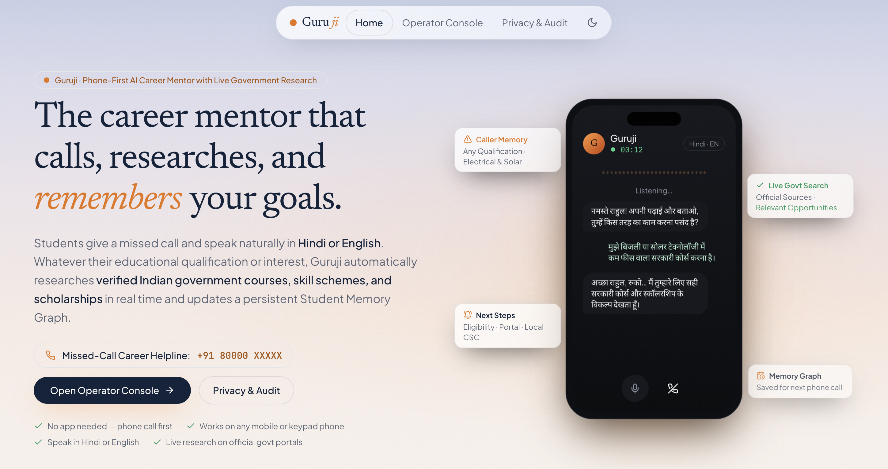
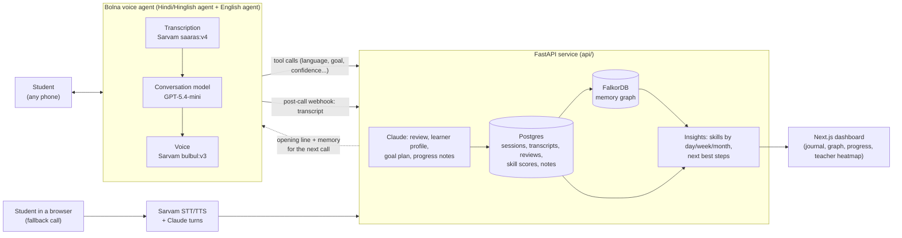

## 📄 [Meet Guruji — View Project Presentation](docs/Guruji-Presentation.pdf)

**A Career Mentor That Calls, Listens & Remembers.**

[](https://voice-agent-nu-drab.vercel.app/)

*Click the preview to open the website preview.*

If the PDF doesn't open on GitHub, [click here to view it on Google Drive](https://drive.google.com/drive/folders/1c1SQvBl7SSmXBtgQSwtMQb72-Y6ZyME_?usp=sharing).

---

# Guruji

**A mentor that calls, listens and remembers.**

Guruji is a voice mentor that talks to a student on an ordinary phone call, in Hindi, English or a mix. It keeps what was said in a memory of that student, so the next call starts where the last one ended.

- **Live demo:** https://voice-agent-nu-drab.vercel.app
- **Demo video (3 min):** [DEMO_VIDEO_URL](DEMO_VIDEO_URL)
- **Full technical write-up** (algorithms, data model, design decisions): [Detail-About-Guruji.md](Detail-About-Guruji.md)

## Contents

1. [Problem](#1-problem)
2. [Solution](#2-solution)
3. [How we use Meta models](#3-how-we-use-meta-models)
4. [Architecture](#4-architecture)
5. [Tech stack](#5-tech-stack)
6. [Setup](#6-setup)
7. [Demo](#7-demo)
8. [Hackathon](#8-hackathon)
9. [Limitations and future work](#9-limitations-and-future-work)
10. [License and team](#10-license-and-team)

## 1. Problem

Mentorship and follow-up with students is inconsistent. A mentor talks to many people, so they forget what was discussed last time. The same mistakes come back call after call, and nobody tracks whether a student is actually improving from one week to the next.

## 2. Solution

Guruji calls the student, or the student talks to it in the browser. After the call, the conversation is turned into notes that the next call uses.

1. **Voice call.** A phone call through Bolna, or a browser call if Bolna is unavailable. Guru asks which language to use on the first call, then speaks only that language.
2. **Each call is stored.** The call becomes a session in Postgres with its transcript. Claude then writes a review (summary, strengths, what to improve, skill scores from 0 to 10, the confidence the student *said* they felt).
3. **A memory graph of the student.** After every call, the student's profile is synced into FalkorDB: goals, skills with their trend, open problems with a root cause and status (new / improving / solved), recurring mistakes, what works for them, books or methods suggested, and self-reported confidence. Maths calls also add a session node and track named misconceptions.
4. **Insights from past calls.** Skill scores by day, week and month; a written progress note for the chosen period; and a ranked list of next best steps, each with the learning-science principle behind it (spacing, deliberate practice, follow-up on open problems and others, in `api/learning_graph.py`).
5. **The next call uses the memory.** The opening line is built from the notes of the last call, and the notes go into the voice agent's prompt.

**What is and isn't tracked, exactly:**
- **Emotions are not extracted.** The system deliberately never guesses feelings from a voice. The only emotion-like signal is **confidence the student states themselves** (1 to 10).
- **Mistakes** are tracked per student (recurring mistakes in coaching calls; named misconceptions with a strength score in maths mode).
- **Community-level patterns** exist as a class heatmap of maths misconceptions on the teacher page (`/teacher`, `api/db.py` `class_heatmap`), built from the seeded class data.

## 3. How we use Meta models

**The code does not call any Meta model.** There is no Meta Model API, Muse Spark or Llama call anywhere in `api/`, `web/`, `scripts/` or the configuration, and `.env.example` has no Meta key. Everything below is what the code actually calls today:

| Step | Model / service | Where |
|---|---|---|
| Live phone conversation: speech to text | Sarvam `saaras:v4` (inside the Bolna agent) | `scripts/bolna_sync_agent.py` |
| Live phone conversation: the replies | Bolna's built-in `gpt-5.4-mini`. Optionally a custom OpenAI-compatible model registered in Bolna, chosen with `BOLNA_LLM=custom` | `scripts/bolna_sync_agent.py`, `api/config.py` |
| Live phone conversation: voice | Sarvam `bulbul:v3`, speaker `priya` | `scripts/bolna_sync_agent.py` |
| Browser call: speech to text and voice | Sarvam `/speech-to-text`, `/text-to-speech` | `api/sarvam.py`, `api/webcall.py` |
| Browser call: each turn of the conversation | Claude (`ANTHROPIC_MODEL`, default `claude-opus-5-5`), JSON-schema output | `api/coach.py` `reply`, `api/llm.py` |
| Post-call review and skill scores | Claude | `api/coach.py` `evaluate` |
| Learner profile (problems, root cause, what works, next topics, next opening line) | Claude | `api/coach.py` `update_profile` |
| 4-week goal plan | Claude | `api/coach.py` `make_plan` |
| Weekly / daily progress note | Claude | `api/coach.py` `progress_feedback`, `POST /students/{id}/coach-feedback` |
| Maths mode: grading free-text answers, memory facts, parent and teacher summaries | Claude | `api/tutor.py`, `api/memory.py`, `api/summaries.py` |
| Fallback when Claude is unavailable | Sarvam chat `sarvam-105b-conversations`, then deterministic scripts | `api/llm.py`, `api/sarvam.py` |
| Devanagari to Latin text for English / Hinglish speakers' transcripts | Sarvam `/transliterate` | `api/sarvam.py` |

All language-model calls go through one function, `chat()` in `api/llm.py`, which tries providers in order. That is the single place where another provider, such as a Meta model, would be added. This has **not** been done.

The console also shows labels such as "Gemini Reasoning". These are interface text only; the backend never calls Gemini (see [limitations](#9-limitations-and-future-work)).

## 4. Architecture



**What each part does**

| Part | Role |
|---|---|
| Bolna | Telephony and the live conversation. Configured from code: `scripts/bolna_sync_agent.py` creates or updates both agents (prompt, tools, webhook, voice). |
| `api/phone.py` | Builds the per-call greeting and memory, answers Bolna's tool calls, and binds the post-call webhook to the right student and session. |
| `api/voice_router.py` | Bolna first; if Bolna reports a limit, the student gets a Sarvam browser-call link instead. |
| `api/coach.py` | Claude turns, post-call review, learner profile, plans and progress notes. Runs after the call, never in the middle of it. |
| `api/learning_graph.py` | Writes the student's coaching state into the graph and ranks the next best steps. |
| `web/` | Dashboard: sign-up, student console with live conversation, memory graph, journal, progress, teacher heatmap, parent summary, privacy export and delete. The browser never sees the admin key; a server-side proxy adds it. |

## 5. Tech stack

- **Backend:** Python 3.13, FastAPI, Uvicorn, Pydantic, psycopg 3 (connection pool), httpx, the Anthropic SDK, `lameenc` (MP3 encoding for faster speech-to-text uploads).
- **Data:** Postgres 16 (source of truth, schema in `sql/schema.sql`) and FalkorDB (the derived memory graph).
- **Voice:** Bolna (phone agent), Sarvam (speech to text, text to speech, transliteration, fallback chat).
- **Language model:** Claude for analysis and browser calls; GPT-5.4-mini inside Bolna for live phone replies.
- **Frontend:** Next.js 14 (App Router), React 18, Tailwind CSS, Framer Motion, Recharts, `react-force-graph-2d`, Lucide icons.
- **Run and deploy:** Docker and Docker Compose, a single-container `Dockerfile` with `start.sh`, Caddy (production profile), a Cloudflare quick tunnel for local phone calls (`scripts/dev_tunnel.py`). The hosted demo uses Vercel for the dashboard, Render for the API and Neon for Postgres.

## 6. Setup

**You need:** Docker Desktop, Python 3.13, Node 20 or newer, and API keys for Bolna and Sarvam (Anthropic is optional; every step has a deterministic fallback).

### Environment variables (`.env.example`)

Copy it to `.env` and fill in the keys. **Never commit `.env`.** There is no Meta key variable, because no Meta model is used.

| Variable | Purpose |
|---|---|
| `LLM_PROVIDER` (`anthropic` \| `sarvam` \| `none`) | Which language model is tried first; the other is the fallback |
| `ANTHROPIC_API_KEY`, `ANTHROPIC_MODEL`, `ANTHROPIC_CHAT_MODEL`, `ANTHROPIC_CHAT_EFFORT`, `ANTHROPIC_EVAL_EFFORT` | Claude settings (turns use low effort, reviews medium) |
| `DATABASE_URL` | Postgres. The default points at the Docker one on port 54322 |
| `FALKORDB_HOST`, `FALKORDB_PORT` | The memory graph |
| `BOLNA_API_KEY`, `BOLNA_AGENT_ID`, `BOLNA_FROM_NUMBER`, `DEMO_STUDENT_PHONE` | Bolna account, agent, caller number and the demo student's phone (a Bolna trial can only call verified numbers) |
| `WEBHOOK_SECRET`, `PUBLIC_BASE_URL` | Shared secret for Bolna's calls to the API, and the public URL Bolna reaches |
| `SARVAM_API_KEY`, `SARVAM_STT_MODEL`, `SARVAM_TTS_MODEL`, `SARVAM_TTS_SPEAKER`, `SARVAM_LLM_MODEL` | Sarvam speech and fallback chat |
| `VOICE_PROVIDER` (`auto` \| `bolna` \| `sarvam`), `BOLNA_COOLDOWN_MINUTES`, `WEB_CALL_LINK_MINUTES` | Voice routing |
| `ADMIN_KEY`, `API_INTERNAL_URL`, `DEMO_MODE` | Protects the dashboard routes; where the dashboard server reaches the API |
| `DASHBOARD_PASSWORD` | Optional login for the whole dashboard (user `guru`) |
| `API_DOMAIN`, `WEB_DOMAIN` | Domains for the production Caddy profile |

> **Change `ADMIN_KEY` and `WEBHOOK_SECRET` before putting anything online.** The values in `.env.example` (`change-me-admin`, `change-me`) are public. Also set `DASHBOARD_PASSWORD` on a public deployment: with it empty, anyone with the dashboard URL can see the students and start calls.

### Run locally

```bash
# 1. configuration
cp .env.example .env            # then fill in the keys

# 2. databases (Postgres on 54322, FalkorDB on 6379)
docker compose --profile local up -d postgres falkordb

# 3. API
python -m venv .venv
.venv/Scripts/pip install -r api/requirements.txt        # macOS/Linux: .venv/bin/pip
.venv/Scripts/python scripts/reset_demo.py               # schema + demo data. This wipes local data
cd api && ../.venv/Scripts/python -m uvicorn main:app --port 8000 --workers 1

# 4. dashboard (new terminal)
cd web && npm install && npx next dev -p 3000            # http://localhost:3000

# 5. only for real phone calls (new terminal): public URL for Bolna
.venv/Scripts/python scripts/dev_tunnel.py               # also re-points both Bolna agents
# then restart the API so it picks up the new PUBLIC_BASE_URL
```

### Run with Docker

```bash
# databases + API + dashboard in containers
docker compose --profile local --profile app up -d --build

# or one container with both (what Render runs): the root Dockerfile builds the dashboard and the API,
# start.sh starts the API on a private port and the dashboard on $PORT
docker build -t guruji .
docker run -p 10000:10000 --env-file .env guruji
```

The single-container image is the one we ran end to end (against a hosted Postgres). Inside a container `DATABASE_URL` and `FALKORDB_HOST` must point at databases the container can reach, not `localhost`.

`scripts/bolna_sync_agent.py` creates or updates the Bolna agents from code (prompt, tools, webhook, voice). Run it again whenever `PUBLIC_BASE_URL` or the prompt changes.

### Tests

```bash
.venv/Scripts/python -m pytest tests -q          # 67 tests; needs Postgres and FalkorDB running
```

Tests blank every API key (`tests/conftest.py`), so they never call paid APIs, and they use their own `*_test` database and graph, so they cannot wipe real data.

## 7. Demo

- **3-minute demo video:** [DEMO_VIDEO_URL](DEMO_VIDEO_URL)
- **Live site:** https://voice-agent-nu-drab.vercel.app
- **Presentation:** [docs/Guruji-Presentation.pdf](docs/Guruji-Presentation.pdf)

## 8. Hackathon

**Meta Global AI Developer Hackathon**. Track: [Indie / Startup]

## 9. Limitations and future work

**Limitations (what is true today)**

- **No Meta model is integrated** (see section 3).
- **Some console panels are interface mock-ups.** "Research Live", "Update Graph & Research with Gemini" and "Push Live Turn" only run a short timer. No Gemini call or web search exists in the backend, and the landing page's wording about live government research describes a direction, not a shipped feature. Each of them still needs a real backend.
- **No live transcript during a phone call.** Bolna sends the transcript after hang-up, so the conversation view fills in when the call ends.
- **Speech recognition on phone audio is imperfect**, especially English spoken by Hindi speakers. We reduced the effect (an English-listening agent for learners who choose English, waiting longer before replying, and prompts that read broken text generously), but it is not solved.
- **The memory graph needs FalkorDB.** Postgres is the source of truth, but the graph view and next-step ranking read from the graph. Without it the console shows an empty graph.
- **Community-level patterns cover maths misconceptions only**, on the seeded class data. Coaching calls produce per-student insights.
- **The 30-case synthetic evaluation behind the Proof page has not been run**, so the repo reports no accuracy numbers.
- **Dashboard login is optional** (`DASHBOARD_PASSWORD`) and off by default.
- **Bolna trial accounts can only call verified numbers.** The API runs one worker because the Bolna cooldown and browser-call sessions are kept in memory.
- **No scheduled calls.** `apscheduler` is a dependency, but nothing calls students on a schedule yet.

**Future work**

- Add a Meta model as a provider in `api/llm.py` and compare it with the current models on the review and profile steps.
- Back the research panel with a real, grounded search of official government portals.
- Run the synthetic evaluation and publish the results.
- Schedule review calls when a skill is due, and add a login for mentors, teachers and parents.

## 10. License and team

**License:** MIT, see [LICENSE](LICENSE).

**Team:** Hacker
